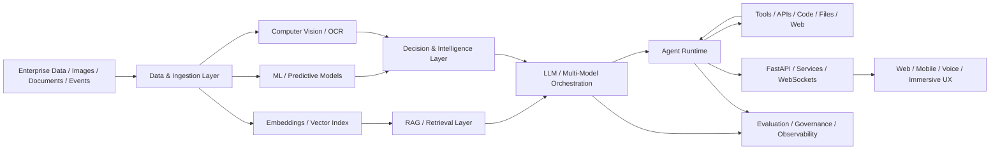

<!--
Dhanumjaya Saggurthi
AI Architect • Applied AI Engineer • AI Product Builder
Portfolio positioning: breadth across GenAI, Agentic AI, RAG, Computer Vision, Predictive AI, Data/Cloud, Multimodal and immersive systems.
-->

  

  
  

<b>I design and build AI systems that can perceive, predict, retrieve, reason, generate, automate, and act.</b>

---

## Who I Am

I am an **AI architect and hands-on applied AI engineer** working across the full AI system lifecycle: data, models, retrieval, agents, APIs, cloud platforms, interfaces, governance, and production delivery.

My work is broader than Generative AI alone. I build across **machine learning, predictive analytics, computer vision, facial recognition, recommendation systems, document intelligence, RAG, agentic AI, multimodal applications, data platforms, and immersive AI experiences**.

I am strongest where architecture and implementation meet: translating a business problem into a working AI system with clear data flows, model behavior, APIs, controls, observability, user experience, and measurable outcomes.

---

## Capability Map

| Area | What I can design and build |
|---|---|
| **Generative AI** | Enterprise assistants, multi-model applications, prompt/orchestration layers, grounded generation, structured outputs |
| **Agentic AI** | Tool-using agents, planning/execution loops, permission gates, human-in-the-loop workflows, autonomous task execution |
| **RAG & Knowledge AI** | Ingestion, chunking, embeddings, metadata, semantic retrieval, vector databases, evaluation, grounded Q&A |
| **Computer Vision** | Facial recognition, image analysis, OCR, visual classification, detection-oriented workflows, vision-enabled applications |
| **Predictive AI / ML** | Regression, classification, forecasting, risk scoring, recommendation, trend prediction, predictive analytics |
| **Document Intelligence** | PDF/image processing, OCR, table extraction, semantic indexing, enterprise knowledge pipelines |
| **Recommendation Systems** | Preference modeling, personalization, ranking, behavioral signals, recommendation workflows |
| **Multimodal AI** | Text, image, voice, file, document and model interactions in unified applications |
| **Data & AI Platforms** | Snowflake, PostgreSQL, pgvector, ETL/ELT, data quality, feature/data pipelines, analytics layers |
| **AI Product Engineering** | FastAPI, React, WebSockets, authentication, streaming, state, admin tooling, deployment patterns |
| **Cloud AI** | Azure/OpenAI integrations, AWS workflows, GCP services, object storage, cloud-native architecture |
| **Immersive / Spatial AI** | WebXR, VR prototypes, AI-powered interactive experiences, voice and spatial interfaces |
| **Decision Intelligence** | BI, dashboards, financial analysis, scenario logic, analytical decision-support systems |

---

## The Kind of Systems I Build

---

## Applied AI Experience

### Agentic & Multi-Model AI

I have built full-stack agentic assistant patterns with:

- Multi-provider model routing across OpenAI/Azure, Anthropic/Bedrock and Gemini-style providers
- Streaming chat and WebSocket interaction
- Tool execution for files, code, web access and document creation
- Permission-based Allow/Deny execution controls
- Isolated per-conversation workspaces
- Cross-conversation context patterns
- Image generation, speech-to-text and text-to-speech
- Authentication, usage monitoring and administrative controls
- PostgreSQL-backed application state and vector-ready storage

### RAG, Search & Document Intelligence

My retrieval work includes:

- PDF parsing and scanned-document OCR
- Table extraction and document normalization
- Chunking and metadata design
- Embedding pipelines
- pgvector / FAISS / vector-search patterns
- Semantic retrieval and grounded response workflows
- S3 and file-system ingestion
- Enterprise knowledge assistant architecture

### Predictive AI & Machine Learning

My ML foundation includes projects and coursework in:

- Predictive analytics and business forecasting
- Multiple linear regression for medical insurance cost prediction
- Classification for employee satisfaction prediction
- Credit-risk modeling and customer credit scoring
- Sales prediction and trend analysis
- Recommendation systems using preference and behavioral data
- Data mining, feature analysis, correlation and model evaluation

### Computer Vision & Visual AI

I work with vision-oriented AI including:

- Facial recognition workflows
- Image analysis and classification concepts
- OCR and scanned-image intelligence
- Vision APIs and image-to-knowledge pipelines
- Multimodal applications combining visual inputs with language models

### AI + Data Platforms

- Snowflake-centered data architecture
- Data quality automation and anomaly workflows
- PostgreSQL + pgvector
- DBT / Airflow / Spark / Kafka patterns
- Cloud ingestion and storage
- Analytics, BI and decision-support systems

### Immersive & Experimental AI

I also explore AI beyond conventional chat interfaces:

- Browser-based WebXR / VR experiences
- Interactive 3D experiences for Meta Quest-class devices
- Spatial audio and narration
- AI-generated voice and visual assets
- Immersive prototypes for product and investor demonstrations

---

## Selected Engineering Evidence

### `agentic-assistant` — private

A full-stack enterprise AI assistant demonstrating multi-model orchestration, agent tools, document generation, voice, image generation, WebSockets, PostgreSQL, pgvector-ready storage, authentication, isolated workspaces, permission controls and administration.

### [`chunk_vectors`](https://github.com/dhanumjayasaggurthi/chunk_vectors) — public

A modular document-ingestion and retrieval system with crawling, PDF processing, OCR, table extraction, chunking, embeddings, PostgreSQL/pgvector, OpenAI integration and AWS/S3 workflows.

### `ai_vr_demo` — private

Immersive WebXR/VR experimentation combining interactive 3D experiences, spatial interaction and AI-generated narration/audio for browser and headset demonstrations.

### `wealth-shield-site` — private

A decision-support product that combines structured financial inputs, calculation logic, analysis, reporting and a production-style React application architecture.

### `aar-labs-ai-showcase` — private

An AI-focused product/site showcasing machine learning, predictive analytics, computer vision, conversational AI, automation and industry AI use cases.

---

## ML & Analytics Foundation

Before the current GenAI wave, my work already covered classical machine learning and analytics:

| Project / Domain | Methods |
|---|---|
| Medical insurance cost prediction | Multiple linear regression, feature analysis, visualization |
| Employee event intelligence | Classification, satisfaction prediction, recommendation, AWS Personalize/Lambda/DynamoDB |
| Credit risk modeling | Classification, risk segmentation, model evaluation |
| Customer credit scoring | EDA, correlation analysis, risk categorization |
| Sales prediction | Predictive modeling, dashboards, business trend analysis |
| Superstore analytics | Data preprocessing, Power BI, Tableau, Python, business reporting |

This foundation matters because I approach GenAI as part of a broader **AI/ML engineering discipline**, not as an isolated chatbot technology.

---

## Technology Stack

### AI / ML

`Python` · `scikit-learn` · `Regression` · `Classification` · `Forecasting` · `Recommendation Systems` · `NLP` · `Computer Vision` · `Facial Recognition` · `OCR`

### GenAI / Agents

`OpenAI` · `Azure OpenAI` · `Anthropic / Bedrock` · `Gemini / Vertex-style integrations` · `RAG` · `Agentic AI` · `Embeddings` · `Tool Calling` · `MCP`

### Data / Retrieval

`Snowflake` · `PostgreSQL` · `pgvector` · `FAISS` · `Pinecone` · `DBT` · `Airflow` · `Spark` · `Kafka` · `S3`

### Application Engineering

`FastAPI` · `React` · `TypeScript` · `WebSockets` · `REST APIs` · `JWT` · `Docker` · `GitHub Actions`

### Analytics / Visualization

`Power BI` · `Tableau` · `Pandas` · `Matplotlib` · `Excel`

### Cloud / Emerging Interfaces

`AWS` · `Azure` · `GCP` · `WebXR` · `VR` · `Voice AI` · `Image Generation`

---

## Architecture Principles

| Principle | Meaning |
|---|---|
| **End-to-end ownership** | AI is not just the model; data, retrieval, APIs, UX, security and operations determine whether the system works. |
| **Use the right AI paradigm** | Not every problem needs an LLM. Use prediction, vision, retrieval, rules, optimization or agents where they fit. |
| **Architecture should be executable** | System diagrams should map to concrete services, contracts, data stores and runtime behavior. |
| **Agents require controls** | Autonomous execution needs permissions, validation, auditability and human intervention points. |
| **Retrieval is a core subsystem** | Chunking, metadata, embeddings, ranking and evaluation deserve first-class engineering attention. |
| **Production before demos** | Reliability, latency, security, cost and maintainability belong in the design from the beginning. |
| **Keep learning across paradigms** | Classical ML, GenAI, computer vision, data engineering and emerging interfaces reinforce one another. |

---

## Professional Development

- AI Lead Architect / Innovation-oriented enterprise AI work
- SnowPro Core certified
- AI Agents and Agentic AI with Python & Generative AI — Vanderbilt University
- Graduate study at Rutgers University with coursework in advanced algorithms, machine learning, and parallel/distributed computing
- Background in predictive analytics, data mining, databases and business forecasting

---

## Current Focus

- Production-grade agentic AI
- Multimodal AI applications
- Enterprise RAG and retrieval quality
- Computer vision and visual intelligence
- Predictive AI and decision systems
- AI-driven automation
- Data + AI platform architecture
- MCP and interoperable tool ecosystems
- Human-in-the-loop autonomous systems
- Spatial and immersive AI interfaces

---

## GitHub Activity

  

  

---

## Contact

  
  

AI systems that perceive • predict • retrieve • reason • generate • automate • act

